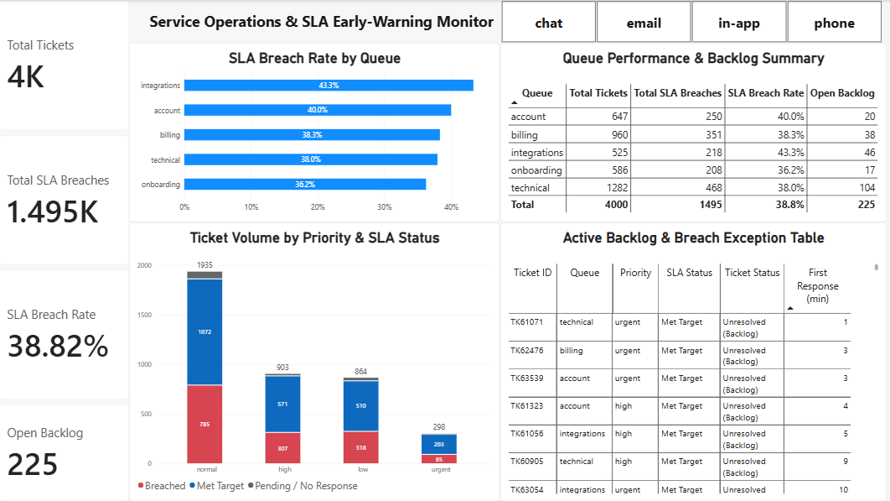

# Service Operations & SLA Early-Warning Monitor

An end-to-end business intelligence and data engineering solution designed to monitor service-level agreement (SLA) compliance, flag queue bottlenecks, and prioritize unresolved ticket backlogs in real time.



---

## Executive Summary
Across **4,000 service interactions**, overall operational performance indicated an SLA breach rate of **38.8%** and an active backlog of **225 unresolved tickets**.

### Key Insights
* **Departmental Bottlenecks:** The **Integrations** queue exhibits the highest breach rate (**43.3%**), closely followed by **Account** services (**40.0%**), pointing to technical dependency delays and onboarding workflow friction.
* **Volume Distribution:** **Technical** and **Billing** handle over **56%** of total incident volume (1,282 and 960 tickets respectively), with Technical holding the largest absolute backlog (**104 open tickets**).
* **Priority Handling:** While urgent tickets have the lowest absolute breach count (85), their breach rate remains elevated given the strict 30-minute SLA constraint.

---

## Architecture & Data Pipeline

```text
support-tickets.csv (4,000 raw records)
         │
         ▼
[MySQL Data Modeling Layer]
  • Timestamp normalization (opened_at, resolved_at)
  • Null handling and empty string sanitation
  • Tiered SLA threshold assignment (Urgent: 30m, High: 60m, Normal: 120m, Low: 240m)
  • Centralized production view: `vw_support_tickets_analytics`
         │
         ▼
[Power BI Desktop Layer]
  • Power Query ETL and strict data typing
  • Dedicated DAX calculation table (`_Measures`)
  • Executive KPI cards, channel slicers, and queue diagnostics
  • Active backlog operational action table
